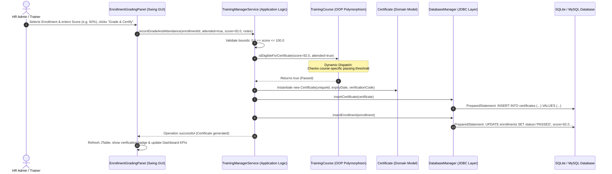

# 🎓 Coursework Technical Specification & System Guide
## Staff Training Management System (STMS)
**Architecture:** 3-Tier Enterprise Desktop Architecture in Java SE  
**IDE:** Apache NetBeans (Maven / Java 17+)  
**Repository Location:** `C:\Users\KARAMUZI\Desktop\StaffTrainingManagementSystem`

---

## 📑 Table of Contents
1. [Coursework Requirements Compliance Matrix](#1-coursework-requirements-compliance-matrix)
2. [High-Level System Architecture](#2-high-level-system-architecture)
3. [Front End Tier (User Interface - Java Swing)](#3-front-end-tier-user-interface---java-swing)
4. [Back End Tier (Application Logic - Java OOP)](#4-back-end-tier-application-logic---java-oop)
5. [Database Connectivity Tier (JDBC)](#5-database-connectivity-tier-jdbc)
6. [Component Integration: How the System Works Together](#6-component-integration-how-the-system-works-together)
7. [How to Open, Build, and Run in Apache NetBeans IDE](#7-how-to-open-build-and-run-in-apache-netbeans-ide)
8. [Database Inspection in NetBeans Services Tab](#8-database-inspection-in-netbeans-services-tab)

---

## 1. Coursework Requirements Compliance Matrix

| Requirement from Coursework Brief | Technology Used | Implementation in STMS | Compliance Status |
| :--- | :--- | :--- | :--- |
| **Standalone Desktop GUI Application** | Java Desktop (SE) | Executable Swing application; no browser or web server needed. | ✅ **100% Compliant** |
| **No Web Technologies (No PHP, HTML, etc.)** | Pure Java SE | 100% Java source code (`.java`); zero web dependencies. | ✅ **100% Compliant** |
| **Front End (User Interface)** | Java Swing / AWT | `JFrame`, `JTabbedPane`, `JTable`, `JDialog`, `CardLayout`, custom theme. | ✅ **100% Compliant** |
| **Back End (Application Logic)** | Java 17+ OOP | Encapsulation, Inheritance, Polymorphism, Abstraction, Factory & Service patterns. | ✅ **100% Compliant** |
| **Database Connectivity** | JDBC (`java.sql.*`) | `DriverManager`, `Connection`, `PreparedStatement`, `ResultSet`, embedded SQLite & MySQL. | ✅ **100% Compliant** |
| **Apache NetBeans Environment** | NetBeans Maven Project | Clean `pom.xml`, standard `src/main/java` structure, 1-click Run (`F6`). | ✅ **100% Compliant** |

---

## 2. High-Level System Architecture

The Staff Training Management System is engineered around a clean **3-Tier Desktop Architecture**:

```mermaid
graph TD
    subgraph "Tier 1: Presentation Tier (Front End)"
        GUI[MainApplicationFrame]
        P1[DashboardPanel]
        P2[StaffManagementPanel]
        P3[CourseCatalogPanel]
        P4[SessionSchedulePanel]
        P5[EnrollmentGradingPanel]
        P6[ReportsPanel]
        P7[DatabaseDiagnosticsDialog]
        GUI --> P1
        GUI --> P2
        GUI --> P3
        GUI --> P4
        GUI --> P5
        GUI --> P6
        GUI --> P7
    end

    subgraph "Tier 2: Business Logic Tier (Back End)"
        SVC[TrainingManagerService Facade]
        FACTORY[CourseFactory]
        MODELS[Domain Models: Person, Employee, Trainer, Course, Session, Enrollment, Certificate]
        REPOS[Repository Layer: InMemory Cache]
        SVC --> FACTORY
        SVC --> MODELS
        SVC --> REPOS
    end

    subgraph "Tier 3: Data Tier (Database Connectivity - JDBC)"
        JDBC[DatabaseManager (JDBC Singleton)]
        SQL[PreparedStatements & DDL SQL Schema]
        DB[(stms.db SQLite Relational Database)]
        CSV[(Backup CSV Storage)]
        JDBC --> SQL
        SQL --> DB
        SVC --> CSV
    end

    GUI -->|User Events & Commands| SVC
    SVC -->|Persistence & Queries| JDBC
    JDBC -->|ResultSets & Entities| SVC
    SVC -->|Data Updates & DTOs| GUI
```

---

## 3. Front End Tier (User Interface - Java Swing)

### 3.1 Graphical Components & Window Organization
The user interface is built using standard Java Swing (`javax.swing.*`) and AWT (`java.awt.*`):

- **`MainApplicationFrame`**: Extends `JFrame`. Acts as the master window container with an enterprise dark header bar, role badge, live JDBC database status button, and a central tabbed pane.
- **`JTabbedPane`**: Provides clean, tab-based navigation across 6 functional workspaces:
  1. **📊 Executive Dashboard (`DashboardPanel`)**: Displays real-time KPI metric summary cards (Total Staff, Active Courses, Scheduled Sessions, Enrollments, Pass Rate %, Certificates Issued) and a live audit log stream.
  2. **👥 Staff Directory (`StaffManagementPanel`)**: Full staff records displayed in a formatted `JTable` with live search, department filtering, "Add Staff" modal dialog, edit, and deletion.
  3. **📚 Course Catalog (`CourseCatalogPanel`)**: Catalog of Technical, Soft Skills, and Compliance courses with category tags, passing criteria, and a modal course creation form.
  4. **📅 Training Sessions (`SessionSchedulePanel`)**: Schedule new instructor-led sessions, enforce seat capacity, view real-time attendee lists, and change session states (`SCHEDULED`, `IN_PROGRESS`, `COMPLETED`, `CANCELLED`).
  5. **📝 Enrollment & Grading (`EnrollmentGradingPanel`)**: Enrolls employees into sessions with capacity checks, marks attendance, records assessment scores (0–100%), and automatically invokes the certification engine.
  6. **📄 Reports & Transcripts (`ReportsPanel`)**: Generates official formatted corporate transcripts and departmental summaries, with 1-click export to a `.txt` file.
- **`DatabaseDiagnosticsDialog`**: A modal dialog (`JDialog`) allowing the user or examiner to test the live JDBC connection, inspect database row counts per table, and review the SQL DDL schema.

### 3.2 Swing Event-Driven Architecture (EDT)
All UI rendering occurs on the **Event Dispatch Thread (EDT)** using `SwingUtilities.invokeLater(...)`.
- **Action Listeners (`ActionListener`)**: Attached to buttons (`btnSave`, `btnDelete`, `btnTestConn`) to handle click interactions.
- **Document Listeners (`DocumentListener`)**: Attached to search text fields to perform instant, real-time filtering as the user types each keystroke.
- **Table Models (`DefaultTableModel`)**: Decouples tabular presentation from underlying entity collections, firing `fireTableDataChanged()` on data updates.

---

## 4. Back End Tier (Application Logic - Java OOP)

The application logic strictly demonstrates the four fundamental pillars of **Object-Oriented Programming (OOP)**:

### 4.1 Encapsulation
- All entity attributes in `com.stms.model.*` are marked `private`.
- Access and mutation are controlled via validated getters and setters:
  - Email addresses are validated for domain formats (`@` and `.`).
  - Score bounds are enforced between `0.0%` and `100.0%`.
  - Negative seat capacities are prevented at the domain model level.
  - Repositories return defensive copies (`new ArrayList<>(storage.values())`) to preserve collection integrity.

### 4.2 Inheritance
Clean, logical inheritance hierarchies model real-world domain relationships:
1. **Person Hierarchy:**
   - Abstract Base Class: `Person` (id, firstName, lastName, email, phone).
   - Subclass: `Employee` (adds department, jobTitle, hireDate, active).
   - Subclass: `Trainer` (adds specialization, yearsOfExperience, hourlyRate, isExternal).
2. **Course Hierarchy:**
   - Abstract Base Class: `TrainingCourse` (id, title, description, durationHours, level, maxCapacity, costPerSeat).
   - Subclass: `TechnicalCourse` (adds `primaryTechStack`, `labAssessmentRequired`).
   - Subclass: `SoftSkillsCourse` (adds `coreCompetency`, `workshopSessionRequired`).
   - Subclass: `ComplianceCourse` (adds `regulatoryStandard`, `mandatoryForEntireCompany`).

### 4.3 Polymorphism (Dynamic Dispatch)
Polymorphic behavior is dynamically dispatched without brittle `if-else` or `switch` statements:
- **Polymorphic Passing Threshold (`getPassingScorePercentage()`):**
  - `TechnicalCourse`: Requires **70.0%** passing score (lab & code benchmark).
  - `SoftSkillsCourse`: Requires **60.0%** passing score (participatory evaluation).
  - `ComplianceCourse`: Requires **85.0%** passing score (strict regulatory legal standard).
- **Polymorphic Certificate Validity (`getCertificateValidityMonths()`):**
  - `TechnicalCourse`: Valid for **36 months** (3 years technology refresh cycle).
  - `SoftSkillsCourse`: Valid for **0 months** (Lifetime validity; skills do not expire).
  - `ComplianceCourse`: Valid for **12 months** (Mandatory annual recertification).
- **Polymorphic Search Matching (`matchesQuery(query)`):**
  - `Person` matches ID, name, email; `Employee` polymorphically extends matching to job title and department; `Trainer` polymorphically extends to specialization.

### 4.4 Abstraction & Interfaces
Decoupled contracts enforce modular architecture:
- `Identifiable`: Universal entity identification contract (`getId()`).
- `Certifiable`: Specification for certificate eligibility rules.
- `Reportable`: Standardized text and transcript generation contract.
- `Searchable`: Unified polymorphic query pattern.
- `Repository<T>`: Generic data access interface decoupling business services from storage.

### 4.5 Design Patterns
- **Service Facade Pattern (`TrainingManagerService`)**: Single unified entry point coordinating transactions, validations, notifications, and storage synchronization.
- **Factory Method Pattern (`CourseFactory`)**: Encapsulates creation of course subclasses based on course category.
- **Singleton Pattern (`DatabaseManager`)**: Ensures a single, thread-safe database connection manager instance.

---

## 5. Database Connectivity Tier (JDBC)

### 5.1 Java Database Connectivity (JDBC) Standard API
Database operations use the official standard Java SE JDBC API (`java.sql.*`):
- **`java.sql.DriverManager`**: Loads and coordinates the JDBC driver (`org.sqlite.JDBC` or `com.mysql.cj.jdbc.Driver`).
- **`java.sql.Connection`**: Maintains the active database session.
- **`java.sql.Statement`**: Executes DDL statements (e.g., `CREATE TABLE IF NOT EXISTS`).
- **`java.sql.PreparedStatement`**: Executes parameterized DML statements (INSERT, UPDATE, DELETE, SELECT) preventing SQL injection attacks.
- **`java.sql.ResultSet`**: Iterates through query result sets and maps rows back to Java domain entities.
- **Resource Management**: Implements `try-with-resources` blocks to guarantee automatic closure of connections, statements, and result sets, preventing connection leaks.

### 5.2 Relational Database Schema (`database/schema.sql`)
The database contains 6 fully normalized tables with primary keys and foreign key constraints:

```sql
-- 1. Employees Table
CREATE TABLE IF NOT EXISTS employees (
    id VARCHAR(50) PRIMARY KEY,
    first_name VARCHAR(100) NOT NULL,
    last_name VARCHAR(100) NOT NULL,
    email VARCHAR(150) NOT NULL,
    phone VARCHAR(50),
    department VARCHAR(50) NOT NULL,
    job_title VARCHAR(100) NOT NULL,
    hire_date DATE NOT NULL,
    active BOOLEAN NOT NULL DEFAULT 1
);

-- 2. Trainers Table
CREATE TABLE IF NOT EXISTS trainers (
    id VARCHAR(50) PRIMARY KEY,
    first_name VARCHAR(100) NOT NULL,
    last_name VARCHAR(100) NOT NULL,
    email VARCHAR(150) NOT NULL,
    phone VARCHAR(50),
    specialization VARCHAR(150) NOT NULL,
    years_of_experience INTEGER NOT NULL,
    hourly_rate DOUBLE NOT NULL,
    is_external BOOLEAN NOT NULL DEFAULT 1
);

-- 3. Courses Table (Polymorphic Course Model)
CREATE TABLE IF NOT EXISTS courses (
    id VARCHAR(50) PRIMARY KEY,
    course_type VARCHAR(50) NOT NULL,
    title VARCHAR(150) NOT NULL,
    description TEXT,
    duration_hours INTEGER NOT NULL,
    course_level VARCHAR(50) NOT NULL,
    max_capacity INTEGER NOT NULL,
    cost_per_seat DOUBLE NOT NULL,
    specific_attribute VARCHAR(200),
    flag_attribute BOOLEAN NOT NULL DEFAULT 0
);

-- 4. Sessions Table
CREATE TABLE IF NOT EXISTS sessions (
    id VARCHAR(50) PRIMARY KEY,
    course_id VARCHAR(50) NOT NULL REFERENCES courses(id),
    course_title VARCHAR(150) NOT NULL,
    trainer_id VARCHAR(50) NOT NULL REFERENCES trainers(id),
    trainer_name VARCHAR(150) NOT NULL,
    session_date DATE NOT NULL,
    time_slot VARCHAR(50) NOT NULL,
    location VARCHAR(150) NOT NULL,
    max_seats INTEGER NOT NULL,
    status VARCHAR(50) NOT NULL
);

-- 5. Enrollments Table
CREATE TABLE IF NOT EXISTS enrollments (
    id VARCHAR(50) PRIMARY KEY,
    session_id VARCHAR(50) NOT NULL REFERENCES sessions(id),
    employee_id VARCHAR(50) NOT NULL REFERENCES employees(id),
    employee_name VARCHAR(150) NOT NULL,
    course_id VARCHAR(50) NOT NULL REFERENCES courses(id),
    course_title VARCHAR(150) NOT NULL,
    enrollment_date DATE NOT NULL,
    attended BOOLEAN NOT NULL DEFAULT 0,
    score DOUBLE,
    status VARCHAR(50) NOT NULL,
    certificate_id VARCHAR(50),
    notes TEXT
);

-- 6. Certificates Table
CREATE TABLE IF NOT EXISTS certificates (
    id VARCHAR(50) PRIMARY KEY,
    enrollment_id VARCHAR(50) NOT NULL REFERENCES enrollments(id),
    employee_id VARCHAR(50) NOT NULL REFERENCES employees(id),
    employee_name VARCHAR(150) NOT NULL,
    course_id VARCHAR(50) NOT NULL REFERENCES courses(id),
    course_title VARCHAR(150) NOT NULL,
    course_category VARCHAR(100) NOT NULL,
    issue_date DATE NOT NULL,
    expiry_date DATE,
    verification_code VARCHAR(100) NOT NULL
);
```

### 5.3 Database Portability: SQLite (Default) and MySQL
- **Embedded SQLite JDBC (`data/stms.db`)**: Pre-configured as the default. Allows the project to run on any computer or inside NetBeans **with zero installation of external database software**. The database file is created automatically on first run.
- **MySQL Connector/J (`com.mysql.cj.jdbc.Driver`)**: Bundled in `pom.xml`. If the instructor requests MySQL, the system can connect via `jdbc:mysql://localhost:3306/stms_db` without code changes.

---

## 6. Component Integration: How the System Works Together

### End-to-End Workflow: Grading an Enrollment & Generating a Certificate
The sequence below illustrates how a user action flows across all three tiers:



---

## 7. How to Open, Build, and Run in Apache NetBeans IDE

### Step 1: Open Apache NetBeans
1. Start **Apache NetBeans IDE** from your Windows Start Menu or Desktop shortcut.
2. Go to the top menu bar: click **File** $\rightarrow$ **Open Project...** (or press `Ctrl + Shift + O`).
3. In the file chooser dialog, navigate to:
   ```
   C:\Users\KARAMUZI\Desktop\StaffTrainingManagementSystem
   ```
4. Apache NetBeans will detect the `pom.xml` file and display the project with a **Maven Java icon**.
5. Select **Staff Training Management System** and click **Open Project**.

### Step 2: Build & Resolve Dependencies
1. Right-click the project root `Staff Training Management System` in the **Projects** panel on the left.
2. Select **Clean and Build**.
3. NetBeans will compile all 42 Java source files and verify the SQLite JDBC dependencies.

### Step 3: Run the Application
1. Click the green **▶ Play** button on the NetBeans toolbar (or press `F6`, or right-click the project $\rightarrow$ **Run**).
2. The standalone desktop GUI will appear on screen!
3. Click the **"🗄️ JDBC Database (SQLite)"** button in the top-right header to verify live JDBC connectivity and review table row counts.

---

## 8. Database Inspection in NetBeans Services Tab

Apache NetBeans includes a built-in database viewer:
1. In NetBeans, open the **Services** window (press `Ctrl + 5` or click **Window** $\rightarrow$ **Services**).
2. Expand the **Databases** node.
3. To view or query `stms.db`:
   - Right-click **Drivers** $\rightarrow$ **New Driver...**
   - Add `target\lib\sqlite-jdbc-3.45.1.0.jar` as the driver file.
   - Enter `jdbc:sqlite:C:\Users\KARAMUZI\Desktop\StaffTrainingManagementSystem\data\stms.db` as the connection URL.
   - Right-click the connection $\rightarrow$ **Connect...**
4. You can now visually view all 6 tables (`employees`, `trainers`, `courses`, `sessions`, `enrollments`, `certificates`) and execute custom SQL queries directly inside NetBeans!

---
*Created for Academic Coursework Evaluation | Java Desktop Standalone Application*
