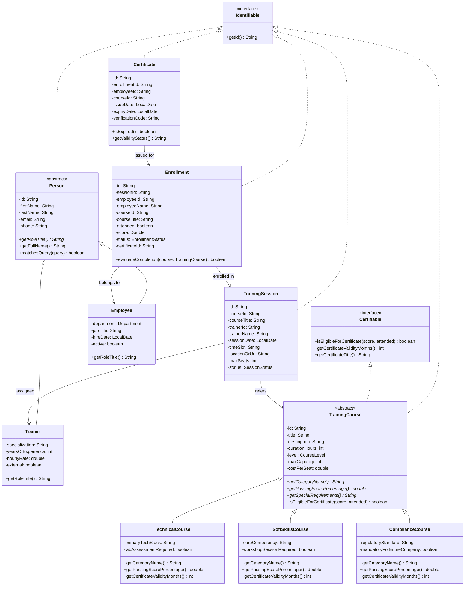
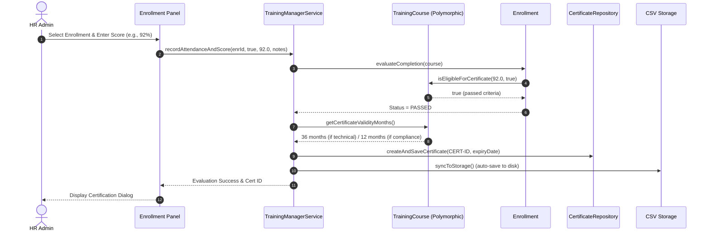

# 📋 Software Requirements Specification (SRS)
## Staff Training Management System (STMS)
**Architecture:** Pure Object-Oriented Programming (OOP) in Java SE  
**Target Environment:** Apache NetBeans IDE (Maven / Java 17+)  
**Version:** 1.0.0 Enterprise Edition  

---

## 1. Executive Summary & Purpose
The **Staff Training Management System (STMS)** is an enterprise desktop application engineered to manage workforce development, skills training, regulatory compliance certification, and scheduling within an organization. 

Modern enterprises face significant challenges tracking employee certifications, meeting compliance deadlines (e.g., GDPR, ISO 27001, OSHA), and allocating training budgets efficiently. STMS provides a unified, structured platform where HR administrators can manage the training catalog, schedule certified sessions, process employee enrollments, evaluate performance, and generate formal credentials and transcripts.

---

## 2. Stakeholders & User Roles

| Role | Responsibilities | Key Operations in STMS |
| :--- | :--- | :--- |
| **HR Administrator** | System governance, employee catalog, compliance auditing | Add/edit staff, define courses via Factory, schedule sessions, view metrics dashboard |
| **Trainer / Instructor** | Delivering curriculum, assessing attendees | Mark attendance, grade quizzes/labs, add trainer evaluation remarks |
| **Employee / Staff** | Workforce learners seeking career development or compliance | Enroll in open courses, view training transcripts, download verified certificates |
| **Department Head** | Oversight of departmental competency & compliance metrics | Review departmental training completion reports and pass rates |

---

## 3. Object-Oriented Principles (OOP) Implementation

STMS is purposefully structured to demonstrate and enforce the core tenets of Object-Oriented Software Engineering:

### 3.1 Encapsulation
- All state variables in domain models are strictly `private`.
- Mutators (`setters`) validate domain invariants (e.g., non-empty strings, valid email formats containing `@`, non-negative capacity, score range between `0.0%` and `100.0%`).
- Internal collections in repositories are encapsulated and returned as defensive copies (`new ArrayList<>(storage.values())`) to preserve internal state integrity.

### 3.2 Inheritance
STMS establishes clean, distinct inheritance hierarchies:
1. **Person Hierarchy:**
   - Base Abstract Class: `Person`
   - Subclass: `Employee` (adds `department`, `jobTitle`, `hireDate`, `active`)
   - Subclass: `Trainer` (adds `specialization`, `yearsOfExperience`, `hourlyRate`, `isExternal`)
2. **Course Hierarchy:**
   - Base Abstract Class: `TrainingCourse`
   - Subclass: `TechnicalCourse` (adds `primaryTechStack`, `labAssessmentRequired`)
   - Subclass: `SoftSkillsCourse` (adds `coreCompetency`, `workshopSessionRequired`)
   - Subclass: `ComplianceCourse` (adds `regulatoryStandard`, `mandatoryForEntireCompany`)

### 3.3 Polymorphism (Dynamic Dispatch)
Polymorphic behavior is applied dynamically across course categories without using messy `if-else` or `switch` type-checking:
- **Polymorphic Passing Threshold (`getPassingScorePercentage()`):**
  - `TechnicalCourse`: Requires **70.0%** passing score (lab & coding benchmark).
  - `SoftSkillsCourse`: Requires **60.0%** passing score (participatory evaluation).
  - `ComplianceCourse`: Requires **85.0%** passing score (strict legal/regulatory standard).
- **Polymorphic Certificate Validity (`getCertificateValidityMonths()`):**
  - `TechnicalCourse`: Valid for **36 months** (3 years technology refresh cycle).
  - `SoftSkillsCourse`: Valid for **0 months** (Lifetime validity; soft skills do not expire).
  - `ComplianceCourse`: Valid for **12 months** (Mandatory annual recertification).
- **Polymorphic Query Matching (`matchesQuery(String query)`):**
  - Base `Person` searches name, ID, and email; `Employee` polymorphically extends search to department and job title; `Trainer` polymorphically extends search to specialization.

### 3.4 Abstraction & Interfaces
Decoupled contracts enforce modularity:
- `Identifiable`: Requires universal `getId()` for repository indexing.
- `Certifiable`: Defines methods `isEligibleForCertificate(score, attended)`, `getCertificateValidityMonths()`, `getCertificateTitle()`.
- `Reportable`: Specifies standardized `toFormattedReport()` text output.
- `Searchable`: Defines unified keyword querying across heterogeneous entities.
- `Repository<T extends Identifiable>`: Generic repository contract decoupling data persistence from service business rules.

### 3.5 Design Patterns
- **Generic Repository Pattern:** Implemented in `Repository<T>` and `InMemoryRepository<T>`.
- **Factory Method Pattern:** Implemented in `CourseFactory.createCourse(...)` to encapsulate complex creation logic of course subtypes.
- **Service Layer / Facade:** Implemented in `TrainingManagerService` to encapsulate transaction coordination, validations, and storage synchronization.

---

## 4. UML Class Architecture

---

## 5. Functional Requirements (FR)

### FR-1: Employee (Staff) Lifecycle Management
- **FR-1.1:** The system shall allow registering new employees with auto-generated unique ID (`EMP-XXXX`), first name, last name, corporate email, phone, department, job title, and active status.
- **FR-1.2:** The system shall enforce non-blank name validation and RFC-compliant email syntax.
- **FR-1.3:** The system shall allow updating existing staff details and deleting records with confirmation prompts.
- **FR-1.4:** The system shall provide real-time searching by employee name, ID, or job title, and filtering by department.

### FR-2: Course Catalog Management via Factory
- **FR-2.1:** The system shall support creating three distinct course categories using the `CourseFactory`:
  - **Technical Courses:** capturing technology stack and practical lab requirements.
  - **Soft Skills Courses:** capturing behavioral competency and role-play workshop requirements.
  - **Compliance Courses:** capturing regulatory body standard and company-wide mandate flag.
- **FR-2.2:** Each course must enforce a positive integer duration (hours) and positive seat capacity.
- **FR-2.3:** The system shall provide real-time search across course titles, categories, and technical stacks.

### FR-3: Training Session Scheduling & Seat Capacity
- **FR-3.1:** The system shall enable scheduling training sessions linking an existing course and an assigned instructor.
- **FR-3.2:** The system shall track available seats and display booked versus maximum capacity (`X / Y`).
- **FR-3.3:** The system shall support session lifecycle transitions: `SCHEDULED` $\rightarrow$ `IN_PROGRESS` $\rightarrow$ `COMPLETED` / `CANCELLED`.
- **FR-3.4:** The system shall allow inspecting registered attendees for any given session.

### FR-4: Staff Enrollment & Business Invariants
- **FR-4.1:** The system shall allow enrolling an employee into a scheduled session.
- **FR-4.2 (Capacity Check):** The system shall reject enrollment if the session has reached its maximum seat capacity.
- **FR-4.3 (Duplicate Check):** The system shall prevent enrolling an employee more than once into the same session.
- **FR-4.4 (Session State Check):** The system shall prevent enrollment into sessions that are already `COMPLETED` or `CANCELLED`.

### FR-5: Attendance, Assessment & Polymorphic Grading
- **FR-5.1:** The system shall record attendance status (`YES` / `NO`) and assessment scores (`0.0%` to `100.0%`).
- **FR-5.2 (Polymorphic Evaluation):** When an evaluation is submitted, the system shall invoke `enrollment.evaluateCompletion(course)`, evaluating the candidate against the course's polymorphic passing criteria:
  - Technical: $\ge 70\%$
  - Soft Skills: $\ge 60\%$
  - Compliance: $\ge 85\%$
- **FR-5.3:** The system shall update enrollment status to `Passed & Certified` or `Needs Retake`.

### FR-6: Automated Certificate Issuance
- **FR-6.1:** When an employee successfully passes an evaluation, the system shall automatically generate a `Certificate` with:
  - Unique ID (`CERT-XXXX`)
  - Verification Code (`STMS-XXXXXXXX`)
  - Issue Date
  - Expiry Date (calculated polymorphically from `course.getCertificateValidityMonths()`).
- **FR-6.2:** Certificates shall link directly to the enrollment record and display validity status (e.g., *Valid until YYYY-MM-DD* or *Lifetime (No Expiry)*).

### FR-7: Official Transcripts & Reporting
- **FR-7.1:** The system shall generate a formal **Staff Training Transcript** containing complete course history, attendance, scores, and active certificates.
- **FR-7.2:** The system shall generate a **Departmental Participation Summary** detailing total staff, enrollments, and certifications per department.
- **FR-7.3:** The system shall allow exporting any generated transcript directly to a text file (`.txt`) on the user's computer.

### FR-8: File Persistence & Auto-Seeding
- **FR-8.1:** The system shall automatically persist all entities (employees, trainers, courses, sessions, enrollments, certificates) into structured CSV files in the `data/` directory.
- **FR-8.2:** If storage files are absent or empty on startup, the system shall seed comprehensive, realistic corporate demo data to enable immediate exploration.

---

## 6. Non-Functional Requirements (NFR)

- **NFR-1 (Portability):** The application shall run smoothly on standard Java SE 17+ and JDK 26+ without external proprietary database installations (e.g., MySQL or Oracle).
- **NFR-2 (IDE Compatibility):** The project must be 100% compliant with **Apache NetBeans IDE**, leveraging Maven's standard directory structure (`pom.xml` + `src/main/java`).
- **NFR-3 (Performance & Responsiveness):** In-memory repositories backed by indexed collections guarantee sub-millisecond CRUD operations and instant UI updates.
- **NFR-4 (UI / UX Polish):** The user interface shall use modern Swing styling, clean visual hierarchy, distinct tab navigation, metrics cards, and intuitive dialogs.
- **NFR-5 (Data Integrity):** File persistence operations use synchronized writers and defensive formatting to prevent corruption or race conditions.

---

## 7. Lifecycle Workflow Diagram

---

## 8. Apache NetBeans Execution Verification
- Project Path: `C:\Users\KARAMUZI\.gemini\antigravity-ide\scratch\StaffTrainingManagementSystem`
- Entry Point: `com.stms.Main`
- Packaged Artifact: `target/staff-training-management-system-1.0.0.jar`
- 1-Click Launch: `run.bat`
